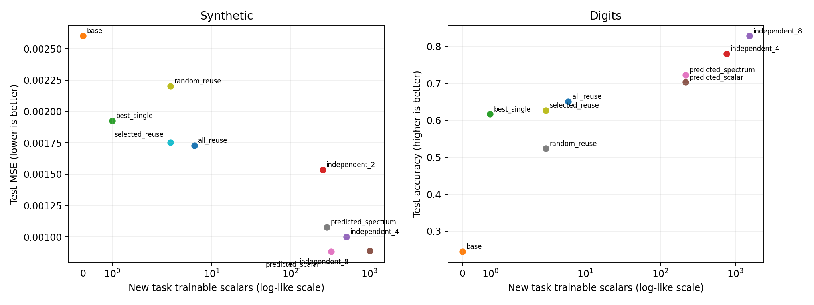
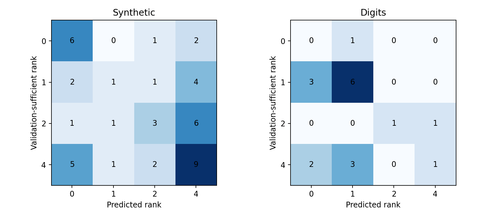

# Predictive reuse of low-rank task adaptations: pilot decision

**Decision: modify, do not pursue the present rank predictor as a standalone contribution.** Reuse is real in the constructed family and some digit transformations, but neither scalar novelty nor the tested spectrum features reliably predicted the smallest validation-sufficient rank. The selection overhead also made the synthetic predictor slower than training an independent adapter in this implementation. Promising follow-up: use an explicit validation-budget or early-stopping policy, test distribution shift in calibration, and compare with direct rank-4 training before investing in a larger study. This pilot does not establish a novel method or real-world continual-learning performance.

## Method and experimental protocol

A frozen MLP receives an additive update on its second weight matrix. Previous rank-2 (synthetic) or rank-4 (digits) updates are independently trained. Their **full matrices** are mixed with fitted coefficients. For each new task, the gradient on a disjoint probe set retrieves the three adapters with highest absolute cosine similarity. Coefficients are optimized on support examples, then a fresh probe gradient at the fitted mixture is projected onto a numerically rank-truncated SVD basis of the selected full updates. Features are residual-to-gradient norm, leading singular-value fraction, and top-two squared-energy fraction. A depth-2 decision tree, trained on separate calibration tasks, maps either the first feature alone or all three to rank 0, 1, 2, or 4. The predicted residual is trained on support data with old updates frozen.

Synthetic: frozen random 32→64→64→8 teacher/student; six orthogonal rank-2 teacher primitives and six independently trained adapters; two nonzero mixture coefficients per new task; extra rank 1/2/4 directions constructed with left and right spaces orthogonal to all primitives. Distractors have no primitive component and rank-4 novelty. Each novel task has separate 64 support, 64 probe, 128 validation, and 128 test samples. Per seed there are five calibration and three test tasks per category. Seeds 0, 1, 2 produce 75 calibration and 45 test tasks in total. Task effects are nonzero: see `effect` in the raw CSV. Primitive training mean MSE was 1.02e-7. A rank is **empirically sufficient** if its validation MSE is at most 1.10 × the best candidate validation MSE plus 1e-6; the smallest such rank is the label. This is relative to the selected three adapters, fixed support budget and optimizer; it is not a proof of minimum functionally necessary rank.

Digits: source images split stratified into 1,078 train, 359 validation, 360 test **before** deterministic transformations; 240 disjoint training images fit new-task coefficients and residuals and 120 others form probes. The clean base uses the whole training partition; old adapters use that partition too. Six old tasks are left/right, ±15° rotations, contrast and blur. Six different transformation combinations calibrate the predictor; four held-out combinations plus 45° rotation and two-pixel upward shift test it. Per seed, there are six calibration and six test tasks. Rank sufficiency uses validation cross-entropy ≤1.05 × best plus 0.005. No task test labels are used for coefficient fitting, selection, rank labels or predictor fitting. The oracle chooses the lowest validation loss from all four residual candidates; it is a high-compute diagnostic, not a fair low-compute baseline. Best-single also uses validation to choose among six candidates; the others do not receive that extra selection data.

Both studies use full-batch Adam, one CPU thread and explicit CPU tensors, without acceleration. Synthetic training uses 300 steps for old adapters and 220 for new residuals, 160 for coefficients; digits uses 180, 140 and 80 respectively. No extensive hyperparameter search was performed. Independent models train from scratch using the same new-task support set and residual training steps. Numbers below are arithmetic means over task/seed pairs; variation and per-task observations are in CSV. The method ordering is not a statistical significance claim.

## Synthetic results

| Method | Test MSE ↓ | New float scalars/task ↓ | Seconds/task ↓ |
|---|---:|---:|---:|
| Frozen base | 0.002600 | 0 | 0 |
| Best single | 0.001924 | 1 | 0.094 |
| All-adapter coefficient mixture | 0.001728 | 6 | 0.018 |
| Random three, coefficients | 0.002202 | 3 | 0.019 |
| Gradient-selected three, coefficients | 0.001754 | 3 | 0.019 |
| Independent rank 2 | 0.001533 | 256 | 0.024 |
| Independent rank 4 | 0.001001 | 512 | 0.025 |
| Independent rank 8 | 0.000889 | 1,024 | 0.023 |
| Predicted rank, scalar | 0.000882 | 330 | 0.039 |
| Predicted rank, spectrum | 0.001076 | 290 | 0.035 |
| Oracle residual rank | 0.000568 | 307 | 0.089 |

On pure combinations, all-adapter and selected-adapter mixture errors round to less than 0.000001, versus 0.000522 for base and 0.000141 for independent rank 4. On rank-4 distractors, all-adapter reuse is 0.002702, scalar prediction 0.001498, and independent rank 4 0.001044. Thus a coefficient mixture can solve the constructed reuse case but cannot by itself recover unrelated directions. Retrieval outperforms random selection in aggregate, although all-six fitting is slightly better than selection at this small library size.

## Digits results

| Method | Test accuracy ↑ | New float scalars/task ↓ | Seconds/task ↓ |
|---|---:|---:|---:|
| Frozen base | 24.46% | 0 | 0 |
| Best single | 61.68% | 1 | 0.065 |
| All-adapter coefficient mixture | 65.03% | 6 | 0.012 |
| Random three, coefficients | 52.39% | 3 | 0.011 |
| Gradient-selected three, coefficients | 62.65% | 3 | 0.012 |
| Independent rank 4 | 78.06% | 768 | 0.020 |
| Independent rank 8 | 82.82% | 1,536 | 0.019 |
| Predicted rank, scalar | 70.31% | 216 | 0.021 |
| Predicted rank, spectrum | 72.27% | 216 | 0.027 |
| Oracle residual rank | 88.19% | 440 | 0.071 |

On the four familiar combinations alone, mixture accuracy is 86.18%, spectrum prediction 88.24%, independent rank 4 87.13%. On the two unfamiliar controls, those figures are 22.73%, 40.32%, and 59.91%, respectively; the oracle achieves 85.42%. The gap between oracle and predictor is particularly large under distribution shift. For example, on the strong-rotation task the scalar predictor scores 41.0%, versus 71.3% for independent rank 4; on the two-pixel shift it scores 33.7% versus 48.5%. These are aggregate over three seeds.

Clean base accuracy ranges from 96.94% to 97.22%. The 18 old-task test accuracies average approximately 94.52% with their original configurations. Since base and old configurations are never changed, their retention follows by construction; a separate sequential post-update retention measurement was not made. The same six new tasks were evaluated independently in a fixed order for each seed; **multiple task sequences were not tested**, so sequence-dependent library growth remains open.

## Rank prediction and ablations

Spectrum predictor confusion, rows = empirical rank, columns = prediction (counts; 45 synthetic tasks):

| Empirical \\ predicted | 0 | 1 | 2 | 4 |
|---|---:|---:|---:|---:|
| 0 | 6 | 0 | 1 | 2 |
| 1 | 2 | 1 | 1 | 4 |
| 2 | 1 | 1 | 3 | 6 |
| 4 | 5 | 1 | 2 | 9 |

Exact empirical-rank accuracy is 19/45 for spectrum and 14/45 for scalar. Spectrum has 8 false-reuse cases (predict 0, empirical rank >0) and 3 false expansions (predict >0, empirical rank 0); scalar has 4 and 7, respectively. Denominators are 36 tasks with empirical rank >0 and 9 with rank 0. Against constructed rank, spectrum is correct 19/45; constructed rank and practical rank differ because old-adapter approximation, retrieval, output sensitivity and optimization matter. Full constructed-rank pairs are in the CSV. On digits, exact empirical-rank accuracy is 8/18 for spectrum and 5/18 for scalar; false reuse is 5/17 and 9/17, while false expansion is 1/1 and 0/1. These tiny denominators make rates unstable.

The spectrum features improve exact rank accuracy over scalar in the main synthetic run, but worsen average MSE (0.001076 vs 0.000882), and do not reliably generalize on digits. Reducing probe size from 64 to 16 changes spectrum exact accuracy from 19/45 to 11/45, and mean MSE from 0.001076 to 0.000938. Reducing primitive training from 300 to 40 steps increases primitive training MSE from 1.02e-7 to 5.27e-5; spectrum exact accuracy changes to 20/45 and MSE to 0.000863. These are small, unreplicated configuration contrasts, not monotonic causal laws; all three seeds were rerun for each. Task similarity sensitivity is visible in the category and control breakdowns above. The predictor's gradient is computed **after** coefficient fitting, so near-stationarity along the selected span can make its residual ratio large even for useful reuse; this is a plausible failure mechanism, not a proven explanation.





## Compute, storage and limitations

Synthetic scalar-predictor mean measured components: initial gradient/retrieval 0.00013 s, coefficient fitting 0.01880 s, second gradient/projection/features and tree prediction 0.00042 s, chosen residual training 0.01991 s; total 0.03926 s. Spectrum total is 0.03534 s. This includes selection but excludes one-time base/library training and calibration. Digits total timings are in the comparison above; its CSV records total but does not break out individual components. Timings are local CPU wall-clock observations, not FLOPs or portable benchmarks. The experiment trains **all** candidate ranks to obtain validation labels and oracle results; the prediction-path timing is assembled from measured component times and the selected candidate's training time, not a separate end-to-end deployment run. This favors the proposed hypothetical online path by excluding the expensive calibration and unselected candidates; even then it is slower than independent rank 4 on synthetic and slightly slower for digits.

Parameter counts are **logical factor-storage estimates**, not actual measured serialized or resident memory. A rank-r synthetic residual needs r×(64+64) floats; a digits residual r×(128+64), plus mixture coefficients. A selected mixture also needs three adapter identifiers; those, the shared base and library, task metadata, and the calibration tree are omitted from the per-task column. For digits the base has 17,226 floats and six rank-4 library adapters would require 4,608 floats in factor form, shared by all tasks. For the six evaluated new tasks, spectrum prediction averages about 1,298 additional floats per seed, versus 36 for all-adapter mixtures and 4,608 for independent rank 4. At float32 these would be about 5.2 KB, 144 B and 18.4 KB respectively, before identifiers and metadata. **The prototype materializes and retains dense updates, does not serialize task configurations or factors, and does not measure process memory; these are not realized storage savings.** Its six dense digits library matrices alone occupy 49,152 float elements in memory, excluding overhead. The chart consequently shows logical added scalar counts, not measured persistent memory. A production implementation must preserve and count actual factors, coefficients, identifiers, predictor state and storage format before making a memory claim.

Additional limitations: rank targets depend on the tolerance, fixed training budget, validation noise and selected subset. A retrieval miss may be misdiagnosed as novelty; the all-library baseline reveals but does not remove this confound. Candidate and independent optimizers received the same step count rather than tuned equal compute; the oracle has much more selection compute and its favorable result may partly reflect extra validation access. The base is a random synthetic MLP, and digits are small, highly structured and share source partitions across tasks; none of this establishes real-world generalization. Only two unfamiliar digit controls and three random seeds are insufficient to characterize uncertainty. We did not directly test multiple task sequences, alternative coefficient budgets, other thresholds, downstream loss targets, or measured serialized memory. In particular, claimed capacity savings on digits must be read alongside the loss in accuracy on controls.

## Prior work and supported claim

[LoRA](https://arxiv.org/abs/2106.09685) established low-rank updates; [LoRAHub](https://arxiv.org/abs/2307.13269) studies cross-task composition and optimization of pretrained adapters. [LoraRetriever](https://aclanthology.org/2024.findings-acl.263/) studies input-aware adapter retrieval and composition. [AdaLoRA](https://arxiv.org/abs/2303.10512) allocates rank budgets adaptively during fine-tuning; it is not a direct pre-training residual predictor. These solve important parts of the setup, and this limited review does not establish priority over all prior work.

The narrow observation supported here is that low-cost full-matrix mixtures can reuse deliberately composable synthetic adaptations and some transformed-digit adapters, while a small calibrated residual-gradient predictor is unreliable on rank and distribution shift in this pilot. It is **not** evidence that the proposed prediction is generally cheaper, that it prevents forgetting beyond frozen task configurations, or that a novel algorithm has been established.

## Reproduction

From this directory, use Python 3.11 with `requirements.txt` installed. No network or dataset download is required after dependencies are present:

```sh
python -m unittest discover -s tests -v
python -m experiments.synthetic_capacity --smoke
python -m experiments.synthetic_capacity
python -m experiments.synthetic_capacity --probe-size 16 --tag synthetic_probe16
python -m experiments.synthetic_capacity --primitive-steps 40 --tag synthetic_weak
python -m experiments.digits_transfer --smoke
python -m experiments.digits_transfer
python -m experiments.make_figures
```

Raw per-task measurements, metadata and logs are in `results/`. The smoke and final runs use the two-sparse construction described above. Runs overwrite files with the same tag. GPU devices are not used.
